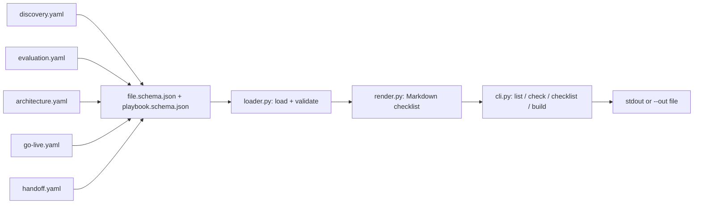

# fde-portfolio

> Structured Forward Deployed Engineering playbook data plus a CLI that renders project checklists for any engagement.

[](https://github.com/mrodgersjs-web/fde-portfolio/actions/workflows/ci.yml)
[](LICENSE)
[](pyproject.toml)

Five engagement-phase playbooks (`discovery`, `evaluation`, `architecture`,
`go-live`, `handoff`) ship as structured YAML, validated against a JSON
Schema, and rendered to Markdown by the `fde-portfolio` CLI. The
checklists are templates: no customer names, no invented outcomes, no
dollar figures.

## Why this exists

Forward Deployed Engineering usually loses on the boring layer between
the demo and production: the operator forgets one approval step, the
handoff doc names no owner, the eval set is shipped without a
known-failure fixture. This repo is the boring layer: five short
playbooks plus a CLI that turns them into a real worksheet, plus tests
that refuse to ship a checklist with a customer name in it.

## The operating record

The playbooks above are the method; [CASE-STUDIES.md](CASE-STUDIES.md) is
the field record: six dated operations on a 366-repo private AI fleet
(storage integrity with hash-gated deletion, a 66-image container migration
with preserved rollback, tri-GPU Blackwell serving restores behind idle
gates, fleet-wide model-routing reconciliation, an MCP process-leak
lifecycle fix). Every case names its evidence tier and carries a not-proven
line, because a playbook without failure modes is marketing. The case set
was gated by an independent 2026-10-30 inventory audit that issued six
required corrections before publication.

How the claims are verified: [AI-ENGINEERING-WORKFLOW.md](AI-ENGINEERING-WORKFLOW.md).
Where each capability lives: [SKILLS-MATRIX.md](SKILLS-MATRIX.md).

## Quick start (5 lines)

```sh
git clone https://github.com/mrodgersjs-web/fde-portfolio.git
cd fde-portfolio
python3 -m venv .venv && source .venv/bin/activate
pip install -e '.[dev]'
fde-portfolio build --project "Acme AI intake" --out /tmp/worksheet.md
```

## Usage

List bundled playbooks:

```
$ fde-portfolio list
id             items  title
-------------- -----  --------------------------------------------------
discovery          8  Discovery playbook
evaluation         7  Evaluation plan playbook
architecture       8  Architecture review playbook
go-live            8  Go-live checklist
handoff            7  Handoff runbook
```

Validate every playbook against the JSON Schema:

```
$ fde-portfolio check
discovery: valid (8 items)
evaluation: valid (7 items)
architecture: valid (8 items)
go-live: valid (8 items)
handoff: valid (7 items)
```

Render the full project worksheet for one engagement:

```
$ fde-portfolio build --project "Acme AI intake"
# Acme AI intake: Forward Deployed Engineering worksheet

Generated by `fde-portfolio` from the bundled playbook data. ...

## Phases

- **Discovery playbook** (8 items)
- **Evaluation plan playbook** (7 items)
- **Architecture review playbook** (8 items)
- **Go-live checklist** (8 items)
- **Handoff runbook** (7 items)

---

# Discovery playbook: Acme AI intake
...
```

## How it works



Every YAML file declares `id`, `phase`, `items[]`; every item
declares `id`, `title`, `description`, `type` (one of `question`,
`task`, `decision`, `evidence`, `owners`). `loader.py` enforces
both schemas and `validate_playbook` returns a list of one-line
problems so a maintainer can fix the data, not the gate.

## What it proves

| Gate | Outcome | Recent run |
| :-- | :-- | :-- |
| `pip install -e '.[dev]'` | installable from a fresh venv on Python 3.10+ | `pip install -e '.[dev]'` |
| `ruff check .` | clean on application source | `ruff check .` |
| `pytest -q --cov` | 44 tests pass, package coverage 85% | `pytest -q --cov` |
| `fde-portfolio check` | every playbook validates against the JSON Schema | `fde-portfolio check` |
| `tests/test_no_client_names_*` | a customer name in any YAML fails the build | `grep` on `playbooks/*.yaml` |
| `tests/test_no_invented_outcomes_*` | a brag-shaped outcome in any YAML fails the build | `grep` on `playbooks/*.yaml` |

If a gate cannot fail, it is theater.

## Project layout

| Path | What it shows |
| :-- | :-- |
| `src/fde_portfolio/` | installable package: loader, renderer, CLI |
| `src/fde_portfolio/playbooks/` | five YAML playbooks (the source of truth) |
| `src/fde_portfolio/schemas/` | two JSON Schemas (file + item) |
| `src/fde_portfolio/py.typed` | type marker for downstream type-checkers |
| `tests/` | 44 tests covering schema, render, CLI, drift scans, repo hygiene |
| `docs/architecture.md` | the data contract and lifecycle diagram |
| `examples/playbook_demo/` | a runnable end-to-end shell demo (no network, no secrets) |
| `scripts/smoke.sh` | legacy file-existence check the docs/ surface relies on |
| `LICENSE` | MIT |
| `.github/workflows/ci.yml` | matrix Python 3.10/3.12; install, lint, tests, gate, smoke |

## Development

```sh
python3 -m venv .venv && source .venv/bin/activate
pip install -e '.[dev]'
ruff check .
pytest -q
fde-portfolio check
```

Add a new checklist item by editing the matching YAML file under
`src/fde_portfolio/playbooks/`. The schemas refuse duplicate ids and
items that miss `title`, `description`, or `type`. `fde-portfolio
check` exits non-zero on any schema violation; the no-client-name and
no-invented-outcome scans run as part of `pytest -q`.

## Contributing

Read [`CONTRIBUTING.md`](CONTRIBUTING.md).

## Security

Read [`SECURITY.md`](SECURITY.md). Email
**security@rodgersintelligence.com** for private disclosures.

## License

MIT: see [`LICENSE`](LICENSE).

<sub>Built by Mike Rodgers · rodgersintelligence.com</sub>
