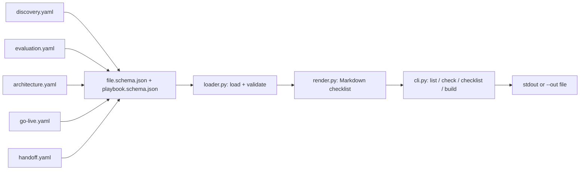
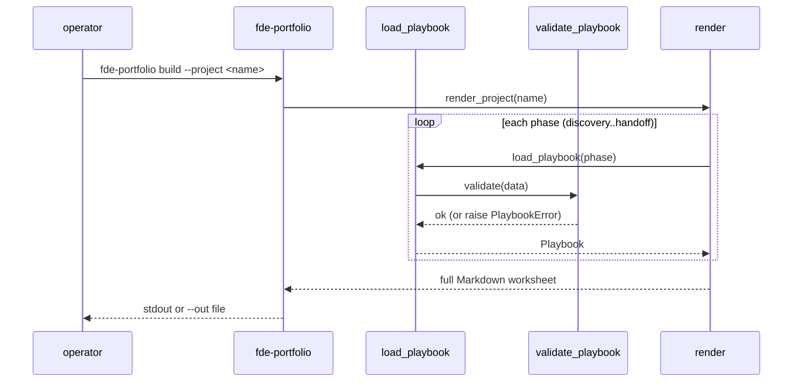

# Architecture

This document describes how `fde-portfolio` is built. Every claim
references the source so a reader can verify it on a fresh checkout.

## What it ships

The repo ships two things:

1. **Five structured playbook data files** in
   `src/fde_portfolio/playbooks/`, one per engagement phase:
   `discovery`, `evaluation`, `architecture`, `go-live`, `handoff`.
2. **A small Python CLI** (`fde-portfolio`) that validates the data
   against a JSON Schema, renders a single playbook as a Markdown
   checklist, or renders the full project worksheet (all five
   phases) for one engagement.

## The data contract

Each playbook YAML has the same shape:

| key | meaning |
|---|---|
| `schema_version` | must be `1` |
| `id` | playbook id, kebab-case |
| `title` | human-readable title |
| `purpose` | one paragraph on why the playbook exists |
| `phase` | one of `discovery`, `evaluation`, `architecture`, `go-live`, `handoff` |
| `items[]` | ordered checklist of `PlaybookItem` objects |
| `see_also[]` | optional refs to docs/ paths or other playbook ids |

Each `PlaybookItem`:

| key | meaning |
|---|---|
| `id` | kebab-case, unique within the playbook |
| `title` | human title; appears in the rendered checklist |
| `description` | plain English; shows up under the checkbox |
| `type` | one of `question`, `task`, `decision`, `evidence`, `owners` |
| `default_owner` | optional suggested owner |
| `example_response` | optional placeholder pattern (`<placeholder: ...>`), never a real customer statement |
| `see_also[]` | optional cross-refs to other items or docs/ paths |

The JSON Schemas live at
`src/fde_portfolio/schemas/{file,playbook}.schema.json` (JSON Schema
2020-12). `validate_playbook(data)` in `loader.py` enforces them on
every load.

## Lifecycle

The same loader is used by the bundled CLI and by any tool that
imports the package. The validator refuses a YAML file with a bad
shape and surfaces the file path plus a one-line reason; CI then
turns that refusal into a build failure on `tests/test_playbooks.py`'s
`test_every_playbook_validates[...]` parametrized over the five
phases.

## How to add or change a checklist item

1. Edit the matching `playbooks/<phase>.yaml`. The id must remain
   unique within the playbook.
2. Run `fde-portfolio check` from the repo root; it must exit 0.
3. Run `pytest -q`. The schema validator, the no-client-name
   scan, and the no-invented-outcome scan all run there.
4. Re-render the project worksheet with
   `fde-portfolio build --project <name> --out /tmp/w.md` and
   eyeball the output once.

## Public guard

The project scans each playbook for two failure modes:

- **Customer names.** The test
  `test_no_client_names_anywhere_in_playbook_data` greps the YAML
  for anything shaped like a real company name and fails the build
  on a hit.
- **Invented outcomes.** The test `test_no_invented_outcomes`
  greps for brag-shaped phrases ("42% reduction", "$120 saved",
  "10x faster") that would tell a reviewer the playbook is making
  promises no portfolio can back up.

## Where this is used

| surface | how |
|---|---|
| Operator pre-engagement | `fde-portfolio build --project <name>` produces the worksheet to walk through with the customer. |
| Operator single phase | `fde-portfolio checklist discovery --project <name>` produces just the discovery checklist. |
| CI drift detection | `fde-portfolio check` runs in CI; failure breaks the build. |
| Import as a library | `from fde_portfolio import load_playbook; pb = load_playbook("go-live")`. |

## Performance budget

The bundled data is small: five YAML files, 38 items total. Parsing
and validating on a cold cache takes well under one second. Rendering
the full project worksheet is dominated by string formatting, also
under a second on a single core. The CLI is not the bottleneck.
